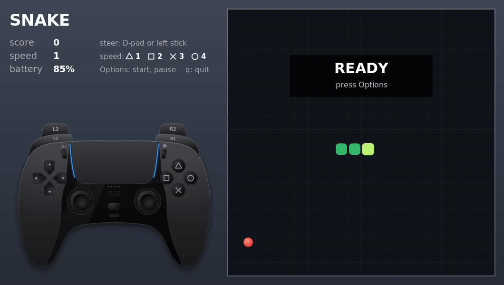
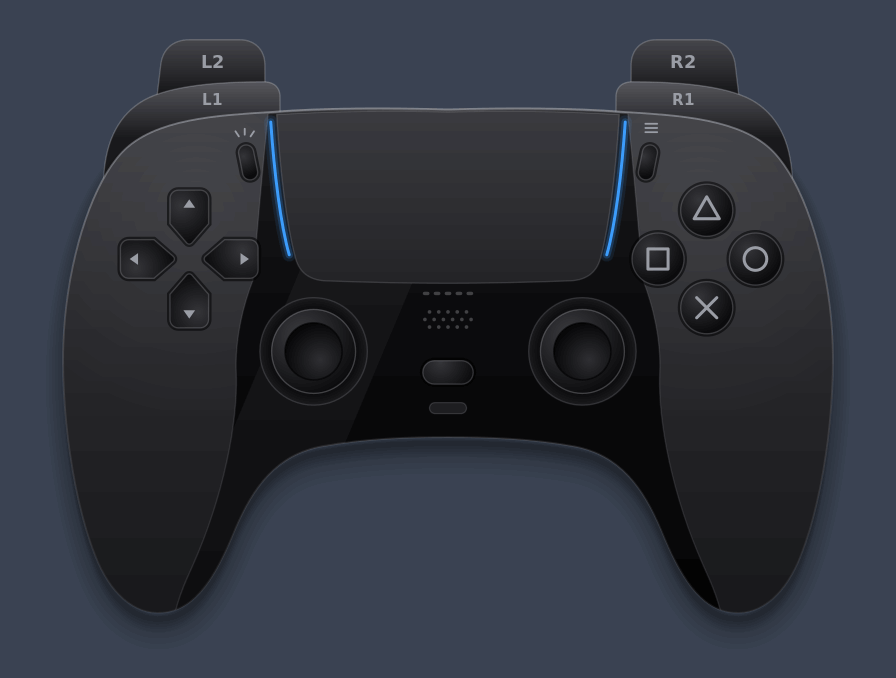

<div align="center">

# dualsense-snake

**A PS5 DualSense on Linux, in plain Python.**

One script pairs the controller over Bluetooth. Then read it from your own code,<br>
watch it live on screen, or just play Snake with it.

<p>


<a href="LICENSE"></a>
</p>

**English** | [简体中文](README.zh-CN.md)



</div>

## What is in here

| File | What it does |
|---|---|
| [`setup.sh`](setup.sh) | Checks the kernel driver and Python, pairs and connects the controller over Bluetooth, and verifies that Python can read it. No root needed. |
| [`dualsense.py`](dualsense.py) | The reader: buttons, sticks, triggers, D-pad and battery level. One file, standard library only. |
| [`padview.py`](padview.py) | A picture of the controller that lights up what you press, drawn with cairo. Runs as a small always-on-top window, or inside your own program. |
| [`snake.py`](snake.py) | Snake, as something to steer. |

## Quick start

```bash
git clone https://github.com/Frank-ZY-Dou/dualsense-snake.git
cd dualsense-snake
./setup.sh
./snake.py
```

`setup.sh` asks you to put the controller into pairing mode: switch it off, then hold **Create** (the small button at the top left of the touchpad) and **PS** together for a few seconds, until the light bar blinks quickly. That is needed once per computer. From then on, pressing PS reconnects the controller. The script prints its messages in Chinese.

You need:

- Linux 5.12 or newer (for the `hid_playstation` driver) and BlueZ. Ubuntu 22.04 has both. Ubuntu 20.04 needs its HWE kernel (5.13 or newer), because its original 5.4 kernel does not ship the driver
- Python 3.8 or newer
- for the two windows, PyGObject with GTK 3 and pycairo. A desktop Ubuntu usually has them already; if not: `sudo apt install python3-gi python3-gi-cairo gir1.2-gtk-3.0`

## Controls

| Controller | Snake |
|---|---|
| D-pad or left stick | steer |
| △ □ ✕ ○ | speed 1, 2, 3, 4 |
| Options | start, pause, new game |

An apple is worth as many points as the current speed. `q` or `Esc` on the keyboard quits.

## The controller on screen



`./padview.py` shows the picture on its own, in a small window at the bottom left of the screen that stays above other windows. Keep it next to whatever the controller is driving.

Buttons light up while they are held, the stick caps move, and L2 and R2 fill up as far as they are pulled. Two things stay dark, the touchpad click and the mute button: the kernel's gamepad device does not report them.

It is a vector drawing, so it stays sharp at any size.

<br clear="right">

To put it into your own GTK or cairo program:

```python
from padview import draw_controller

draw_controller(cr, pad, x, y, width)   # cr is a cairo context
```

## Reading the controller in your own program

`dualsense.py` has no dependencies and does not need the other files.

```python
import select
from dualsense import DualSense

with DualSense() as pad:
    print(pad.name, pad.connection, pad.battery())
    while True:
        select.select([pad], [], [])     # sleep until something happens
        for event in pad.poll():         # Event(kind, name, value)
            print(event)
        if pad.buttons["cross"] and pad.axes["left_y"] < -0.5:
            ...                          # the current state is always there
```

| | Names |
|---|---|
| Buttons | `cross` `circle` `triangle` `square` `l1` `r1` `l2` `r2` `create` `options` `ps` `l3` `r3` |
| Axes | `left_x` `left_y` `right_x` `right_y` `l2_trigger` `r2_trigger` `dpad_x` `dpad_y` |

Axes run from -1.0 to 1.0. x grows to the right and y downwards, so a stick pushed forward reads -1.0. A released trigger reads -1.0, a fully pulled one 1.0.

The object has a `fileno()`, so it plugs into `select`, `asyncio` or a GLib main loop. Run as a program, the file prints what it found:

```console
$ python3 dualsense.py
controller : DualSense Wireless Controller
device     : /dev/input/js0 (bluetooth)
battery    : 95% (Charging)
inputs     : 13 buttons, 8 axes
```

## How it works

The kernel driver `hid_playstation` turns the controller into ordinary input devices. This project reads the plainest of them, the joystick device `/dev/input/jsN`. Any user may read it, so there are no udev rules to install, and an event is eight bytes. `dualsense.py` asks the driver once which button and axis each number stands for, and from then on it only reads events. The battery level comes from `/sys/class/power_supply`.

Pairing is where the script earns its place. On the machine this was written on, `bluetoothctl show` said `Pairable: no`. In that state `bluetoothctl pair` still reports success, but BlueZ does not keep the pairing, and it then refuses the controller's input connection; the log of `bluetoothd` says `Rejected connection from !bonded device`. `setup.sh` makes the adapter pairable while it pairs, trusts the controller so that it may reconnect by itself, and puts the setting back afterwards.

## Notes

- If the controller was paired with a console or another computer in the meantime and no longer reconnects, run `./setup.sh --repair`.
- `snake.py` and `padview.py` start with `#!/usr/bin/python3` on purpose, because GTK belongs to the system Python. Inside conda or a virtualenv, `python3 snake.py` does not find it; `./snake.py` does.
- The driver also registers the touchpad as a mouse. On X11, `xinput disable "DualSense Wireless Controller Touchpad"` stops that.
- Tested on Ubuntu 22.04 (X11 session, kernel 6.8, BlueZ 5.64, Python 3.10) with a standard DualSense over Bluetooth. Not tested: Ubuntu 20.04, a Wayland session (there `padview.py` runs through XWayland, the only way for a window to place itself and stay on top), USB, and the DualSense Edge.

## License

[MIT](LICENSE). DualSense and PlayStation are trademarks of Sony Interactive Entertainment. This project is not affiliated with Sony.
