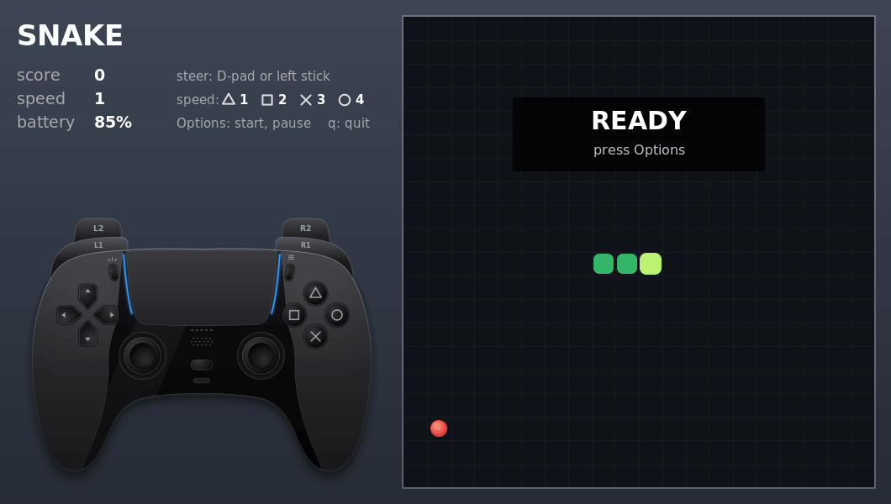
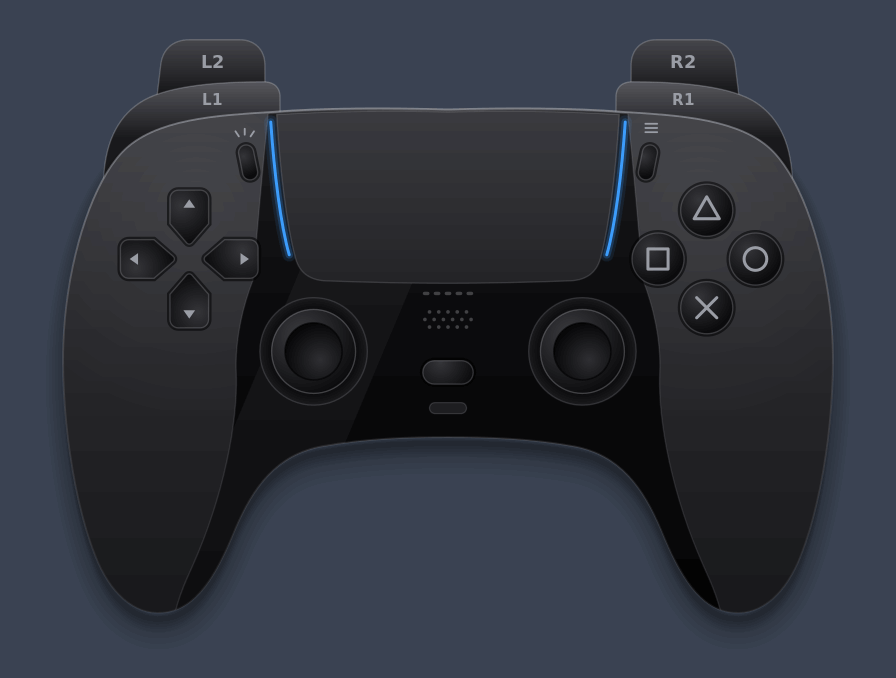

<div align="center">

# dualsense-snake

**Linux 上的 PS5 DualSense 手柄，纯 Python。**

一个脚本完成蓝牙配对。之后可以在自己的程序里读取手柄，<br>
在屏幕上实时看到按了哪里，或者直接玩一局贪吃蛇。

<p>


<a href="LICENSE"></a>
</p>

[English](README.md) | **简体中文**



</div>

## 里面有什么

| 文件 | 作用 |
|---|---|
| [`setup.sh`](setup.sh) | 检查内核驱动和 Python，通过蓝牙配对并连接手柄，最后确认 Python 能读到它。不需要 root。 |
| [`dualsense.py`](dualsense.py) | 读取手柄：按键、摇杆、扳机、方向键和电量。单个文件，只用标准库。 |
| [`padview.py`](padview.py) | 一张会点亮按键的手柄图，用 cairo 绘制。可以作为置顶小窗口单独运行，也可以画进你自己的程序。 |
| [`snake.py`](snake.py) | 贪吃蛇，用来试手柄。 |

## 快速开始

```bash
git clone https://github.com/Frank-ZY-Dou/dualsense-snake.git
cd dualsense-snake
./setup.sh
./snake.py
```

`setup.sh` 会提示你让手柄进入配对模式：先关掉手柄，再同时按住 **Create** 键（触摸板左上方的小键）和 **PS** 键几秒，直到灯条快速闪烁。每台电脑只需要配对一次，之后按一下 PS 键就会自动连上。

需要：

- Linux 5.12 或更新的内核（`hid_playstation` 驱动）和 BlueZ。Ubuntu 22.04 都自带。Ubuntu 20.04 需要换用 HWE 内核（5.13 或更新），因为它原装的 5.4 内核没有这个驱动
- Python 3.8 或更新版本
- 两个窗口程序还需要 PyGObject（GTK 3）和 pycairo。Ubuntu 桌面版一般已经装好，没有的话：`sudo apt install python3-gi python3-gi-cairo gir1.2-gtk-3.0`

## 操作

| 手柄 | 贪吃蛇 |
|---|---|
| 方向键或左摇杆 | 转向 |
| △ □ ✕ ○ | 速度 1、2、3、4 |
| Options | 开始、暂停、重新开始 |

每吃一个苹果，得分等于当前速度。键盘按 `q` 或 `Esc` 退出。

## 屏幕上的手柄



`./padview.py` 单独显示这张图：屏幕左下角的一个小窗口，始终在其他窗口上面，可以放在手柄正在控制的程序旁边。

按住的键会发光，摇杆帽会跟着移动，L2 和 R2 按下多深就填充多高。触摸板按压和静音键不会亮，因为内核的手柄设备不上报它们。

图是矢量绘制的，放大缩小都清晰。

<br clear="right">

画进你自己的 GTK 或 cairo 程序：

```python
from padview import draw_controller

draw_controller(cr, pad, x, y, width)   # cr 是 cairo context
```

## 在自己的程序里读取手柄

`dualsense.py` 没有依赖，也不需要其他几个文件。

```python
import select
from dualsense import DualSense

with DualSense() as pad:
    print(pad.name, pad.connection, pad.battery())
    while True:
        select.select([pad], [], [])     # 没有输入时休眠
        for event in pad.poll():         # Event(kind, name, value)
            print(event)
        if pad.buttons["cross"] and pad.axes["left_y"] < -0.5:
            ...                          # 当前状态随时可读
```

| | 名称 |
|---|---|
| 按键 | `cross` `circle` `triangle` `square` `l1` `r1` `l2` `r2` `create` `options` `ps` `l3` `r3` |
| 轴 | `left_x` `left_y` `right_x` `right_y` `l2_trigger` `r2_trigger` `dpad_x` `dpad_y` |

轴的取值从 -1.0 到 1.0。x 向右增大，y 向下增大，所以摇杆向前推是 -1.0。扳机松开是 -1.0，按到底是 1.0。

对象带有 `fileno()`，可以直接用在 `select`、`asyncio` 或 GLib 的主循环里。把这个文件当程序运行，会打印它找到的手柄：

```console
$ python3 dualsense.py
controller : DualSense Wireless Controller
device     : /dev/input/js0 (bluetooth)
battery    : 95% (Charging)
inputs     : 13 buttons, 8 axes
```

## 工作原理

内核驱动 `hid_playstation` 把手柄变成普通的输入设备。这个项目读的是其中最简单的一个：joystick 设备 `/dev/input/jsN`。任何用户都能读它，所以不用装 udev 规则，一个事件只有 8 个字节。`dualsense.py` 先问一次驱动每个编号对应哪个按键和轴，之后只管读事件。电量来自 `/sys/class/power_supply`。

配对是这个脚本真正有用的地方。在写这个项目的机器上，`bluetoothctl show` 显示 `Pairable: no`。这种状态下 `bluetoothctl pair` 仍然报告成功，但 BlueZ 并不保存配对，接着就拒绝手柄的输入连接，`bluetoothd` 的日志里是 `Rejected connection from !bonded device`。`setup.sh` 在配对期间把适配器设为可配对，把手柄设为信任设备，这样它以后可以自己回连，配对结束后再把设置改回去。

## 说明

- 如果手柄中途配对过主机或别的电脑，回连不上了，运行 `./setup.sh --repair`。
- `snake.py` 和 `padview.py` 的第一行特意写成 `#!/usr/bin/python3`，因为 GTK 属于系统 Python。在 conda 或 virtualenv 里，`python3 snake.py` 找不到它，`./snake.py` 可以。
- 驱动还会把触摸板注册成鼠标。在 X11 下，`xinput disable "DualSense Wireless Controller Touchpad"` 可以关掉。
- 在 Ubuntu 22.04（X11 会话、内核 6.8、BlueZ 5.64、Python 3.10）上用标准版 DualSense 通过蓝牙测试过。没有测试过的：Ubuntu 20.04、Wayland 会话（这时 `padview.py` 通过 XWayland 运行，只有这样窗口才能自己定位并保持置顶）、USB 连接和 DualSense Edge。

## 许可

[MIT](LICENSE)。DualSense 和 PlayStation 是 Sony Interactive Entertainment 的商标，本项目与 Sony 无关。
